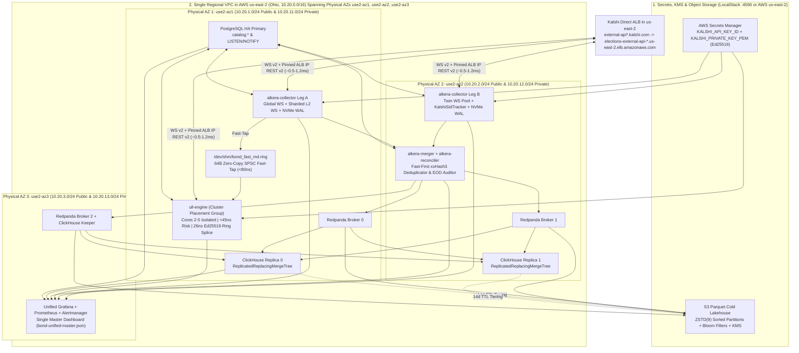

# Project Bond: Unified System Architecture, Deterministic Rust Engineering Standards, LocalStack/AWS Terraform IaC & Production Readiness Specification

## 1. Executive Summary & Core Architectural Decisions

This specification defines the unified **100% Rust** system architecture, **deterministic engineering & regression testing standards**, **Terraform Infrastructure-as-Code (`infra/terraform/` with first-class LocalStack support)**, **Unified Master Grafana Dashboard**, and **production blind-spot mitigations** for **Project Bond**.

### Core Scope & Architectural Decisions

1. **Kalshi-First Active Scope in a Single `us-east-2` VPC (`enable_polymarket = false` by default)**:
   - **Active Focus**: All primary data capture (`alkera-collector`), cataloging (`alkera-catalog`), deduplication (`alkera-merger`), storage (`ClickHouse` + `S3 Parquet`), and ultra-low-latency execution (`ull-kalshi` + `ull-engine`) are actively focused on **Kalshi API v2 (`AWS us-east-2` Ohio)** using Ed25519 authentication (`KALSHI_API_KEY_ID` and `KALSHI_PRIVATE_KEY_PEM` / `KALSHI_PRIVATE_KEY_PATH`).
   - **Single-VPC Deployment (`10.20.0.0/16` in `us-east-2`)**: Because all Kalshi workloads and the entire data/observability stack reside in `us-east-2` (Ohio), **100% of the active infrastructure runs inside a single regional AWS VPC (`10.20.0.0/16`)** spanning physical Availability Zones `use2-az1`, `use2-az2`, and `use2-az3` with **zero VPC peering hops** and sub-millisecond intra-VPC routing.
   - **Why Optional Cross-Region Peering Exists Only When `enable_polymarket = true`**: In AWS, a VPC is a strictly regional construct—it can span multiple Availability Zones within `us-east-2`, but it cannot span across AWS regions into Europe (`eu-west-1` / `eu-west-2`). Therefore, the European VPCs and Inter-Region VPC Peering resources are gated behind `enable_polymarket = false` and are only provisioned if Polymarket is enabled in the future.
2. **LocalStack-First AWS Infrastructure Validation (`http://localhost:4566`)**:
   - Every Terraform module under `infra/terraform/` supports a single-toggle **LocalStack mode (`use_localstack = true` via `localstack.tfvars`)** that redirects all AWS provider endpoints (`s3`, `secretsmanager`, `ssm`, `kms`, `iam`, `sts`, `ec2`) to `http://localhost:4566` with `s3_use_path_style = true`.
   - Developers and CI pipelines validate the complete Terraform plan/apply, AWS Secrets Manager key retrieval (`KALSHI_API_KEY_ID`, `KALSHI_PRIVATE_KEY_PEM`), and S3 Parquet lakehouse writes locally against LocalStack before promoting the identical HCL modules to production AWS `us-east-2`.
3. **Unified Path 1 (ULL Execution) + Path 2 (HA Data Lakehouse) Monorepo**:
   - Shares a single canonical fixed-point schema (`crates/alkera-schema`: `PriceMicros(u32)`, `SizeMicros(i64)`, `InstrumentIid(u32)`, `MarketUid(u32)`) across both the HA data layer and the ULL execution engine.
   - Couples the co-located local `alkera-collector` and `ull-engine` via a **zero-copy `/dev/shm/bond_fast_md.ring` SPSC shared-memory fast-tap (`< 80 ns`)** so verified L2 orderbook deltas trigger execution in nanoseconds before touching Redpanda or ClickHouse.
4. **Fully Unified Single-Pane-of-Glass Master Grafana Dashboard (`bond-unified-master.json`)**:
   - Auto-provisions Prometheus (`1s` scrape interval), ClickHouse SQL (`market_data`), and PostgreSQL (`catalog`) datasources into a **single master Grafana dashboard** (`infra/terraform/modules/observability/dashboards/bond-unified-master.json`) spanning 7 end-to-end operational rows: (1) Kalshi WS Collectors, (2) Active-Active Deduplicator & `/dev/shm` Fast-Tap, (3) Local NVMe WAL & Redpanda Bus, (4) PostgreSQL Catalog & `instrument_iid` Interner, (5) ClickHouse Hot Store & LocalStack/S3 Parquet Lakehouse, (6) AWS Nitro `/dev/ptp0` PTP Clock Sync, and (7) ULL Execution Latency, Pre-Signed Ring & Pre-Trade Risk / Kill-Switch.
5. **Rigorous Deterministic Unit, Property (`proptest`), Concurrency (`loom`) & Golden-Corpus Regression Testing**:
   - Enforces a 5-tier automated testing & regression gate on every commit, coupled with workspace-wide Clippy denials (`clippy::float_arithmetic`, `clippy::unwrap_used`, `clippy::expect_used`, `clippy::panic`, `unsafe_op_in_unsafe_fn`).

---

## 2. Unified End-to-End Architecture (Single `us-east-2` VPC + LocalStack Parity)

### 2.1 System Dataflow Diagram Inside the Single `us-east-2` VPC (`10.20.0.0/16`)



---

### 2.2 Canonical Fixed-Point Types Shared Across All Crates (`crates/alkera-schema`)

To eliminate any impedance mismatch between Path 2 (`alkera-*` data layer) and Path 1 (`ull-*` execution engine), both subsystems compile against `crates/alkera-schema` with **zero floating-point types (`#![deny(clippy::float_arithmetic)]`)**:

```rust
// crates/alkera-schema/src/primitives.rs
#![forbid(unsafe_code)]
#![deny(clippy::float_arithmetic)]

/// Exact micro-dollar price representation: $1.000000 = 1_000_000.
/// Represents Kalshi cent ($0.01 = 10,000), deci-cent ($0.001 = 1,000),
/// and Kalshi V2 4-decimal ticks ($0.0001 = 100) without rounding error.
#[repr(transparent)]
#[derive(
    Clone, Copy, Debug, Default, PartialEq, Eq, PartialOrd, Ord, Hash,
    rkyv::Archive, rkyv::Serialize, rkyv::Deserialize,
)]
#[archive(check_bytes)]
pub struct PriceMicros(pub u32);

impl PriceMicros {
    pub const ZERO: Self = Self(0);
    pub const ONE_DOLLAR: Self = Self(1_000_000);
    pub const MIN_VALID_TICK: Self = Self(100);       // $0.0001
    pub const MAX_VALID_TICK: Self = Self(999_900);   // $0.9999

    /// Kalshi YES/NO complement identity: P_no = $1.000000 - P_yes
    #[inline(always)]
    pub const fn complement(self) -> Self {
        Self(Self::ONE_DOLLAR.0.saturating_sub(self.0))
    }

    /// Converts micro-dollars to Kalshi V2 4-decimal ticks ($0.5600 -> 5600)
    #[inline(always)]
    pub const fn to_ticks_4dp(self) -> u32 {
        self.0 / 100
    }

    #[inline(always)]
    pub const fn from_ticks_4dp(ticks: u32) -> Self {
        Self(ticks.saturating_mul(100))
    }
}

/// Exact micro-contract quantity representation: 1.000000 contract = 1_000_000.
/// Signed to represent both absolute book quantities and relative Kalshi orderbook deltas.
#[repr(transparent)]
#[derive(
    Clone, Copy, Debug, Default, PartialEq, Eq, PartialOrd, Ord, Hash,
    rkyv::Archive, rkyv::Serialize, rkyv::Deserialize,
)]
#[archive(check_bytes)]
pub struct SizeMicros(pub i64);

impl SizeMicros {
    pub const ZERO: Self = Self(0);
    pub const ONE_CONTRACT: Self = Self(1_000_000);

    /// Converts micro-contracts to Kalshi V2 2-decimal centi-contracts (1.00 contract = 100)
    #[inline(always)]
    pub const fn to_centi_contracts(self) -> u32 {
        if self.0 <= 0 {
            0
        } else {
            (self.0 / 10_000) as u32
        }
    }

    #[inline(always)]
    pub const fn from_centi_contracts(centi: u32) -> Self {
        Self((centi as i64).saturating_mul(10_000))
    }
}

/// Dense 32-bit surrogate instrument identifier assigned by PostgreSQL `catalog.instruments`
/// (`<ticker>:YES` and `<ticker>:NO` cross-linked via `complement_iid`).
#[repr(transparent)]
#[derive(
    Clone, Copy, Debug, Default, PartialEq, Eq, PartialOrd, Ord, Hash,
    rkyv::Archive, rkyv::Serialize, rkyv::Deserialize,
)]
#[archive(check_bytes)]
pub struct InstrumentIid(pub u32);

/// Kalshi matching engine shard index (`?exchange_index=0..3`)
#[repr(u8)]
#[derive(Clone, Copy, Debug, PartialEq, Eq, Hash, rkyv::Archive, rkyv::Serialize, rkyv::Deserialize)]
#[archive(check_bytes)]
pub enum KalshiExchangeShard {
    DefaultMacroPolitics = 0,
    ExoticsCombosRfq = 1,
    CryptoCommodities = 2,
    Sports = 3,
}
```

---

### 2.3 Zero-Copy `/dev/shm` SPSC Fast-Tap Between Local Collector and ULL Engine

On the primary `us-east-2` (`use2-az1`) node, `alkera-collector` (Path 2) and `ull-engine` (Path 1) communicate via a memory-mapped POSIX shared-memory SPSC ring buffer (`/dev/shm/bond_fast_md.ring`):

1. **Immediate `< 80 ns` Local Book Forwarding**:
   - The instant `alkera-collector` parses an incoming Kalshi `orderbook_delta`, `trade`, or `ticker` frame via `simd-json` and verifies `(sid, seq)` continuity in its single-writer `FlatOrderBook`, it writes a 64-byte cache-line-aligned `ShmFastMarketUpdate` into `/dev/shm/bond_fast_md.ring` (`Ordering::Release`) **before** writing to the NVMe WAL or Redpanda.
   - `ull-engine` Core 3 spin-polls `/dev/shm/bond_fast_md.ring` alongside its own dedicated ultra-hot WebSocket connection, deduplicating by `(instrument_iid, seq)` so Core 4 fires pre-signed Kalshi orders within `< 15 µs` of packet arrival.

```rust
/// 64-byte cache-line-aligned zero-copy shared memory packet between
/// `alkera-collector` (Path 2) and `ull-engine` (Path 1) over `/dev/shm/bond_fast_md.ring`.
#[repr(C, align(64))]
#[derive(Clone, Copy, Debug, PartialEq, Eq)]
pub struct ShmFastMarketUpdate {
    pub seq_lock: u64,               // Monotonic sequence number (even = valid, odd = writing)
    pub recv_ts_ns: u64,             // CLOCK_REALTIME_NS (PTP-disciplined) at socket read
    pub exchange_ts_ms: u64,         // Kalshi exchange timestamp (ms)
    pub instrument_iid: u32,         // Surrogate key from catalog.instruments
    pub market_uid: u32,             // Surrogate key from catalog.markets
    pub best_bid_micros: u32,        // Verified YES best bid ($1.00 = 1_000_000)
    pub best_ask_micros: u32,        // Verified YES best ask ($1.00 - NO best bid)
    pub best_bid_size_micros: u64,   // Available contracts at YES best bid
    pub best_ask_size_micros: u64,   // Available contracts at YES best ask
    pub venue_id: u8,                // 1 = Kalshi (2 = Polymarket when enabled)
    pub kalshi_shard: u8,            // exchange_index (0..=3)
    pub book_state_flags: u8,        // Bit 0: Seq verified, Bit 1: Twin healed, Bit 2: Halted/Desynced
    pub _pad: [u8; 5],
}
const _: () = assert!(std::mem::size_of::<ShmFastMarketUpdate>() == 64);
```

---

### 2.4 Kalshi WebSocket & REST Authentication Contract (`KALSHI_API_KEY_ID` + Ed25519)

Both `alkera-collector` (when opening WebSocket connections to `wss://external-api-ws.kalshi.com/trade-api/ws/v2`) and `ull-engine` (when pre-signing REST v2 orders to `https://external-api.kalshi.com/trade-api/v2`) use the exact same Ed25519 signature specification:

- **Credentials Loaded from Environment or AWS Secrets Manager (LocalStack / AWS `us-east-2`)**:
  - `KALSHI_API_KEY_ID` (or per-role `KALSHI_CAPTURE_A_API_KEY_ID`, `KALSHI_CAPTURE_B_API_KEY_ID`, `KALSHI_EXEC_API_KEY_ID`)
  - `KALSHI_PRIVATE_KEY_PEM` / `KALSHI_PRIVATE_KEY_PATH` (PKCS#8 Ed25519 private key)
- **Exact Signing Payload**:
  - String to sign: `"{timestamp_ms}{HTTP_METHOD}{path_without_query}"`
  - For WebSocket v2 handshake: `"{timestamp_ms}GET/trade-api/ws/v2"`
  - For REST v2 order creation (`POST /trade-api/v2/portfolio/events/orders?exchange_index=2`): strip `?exchange_index=2` and sign `"{timestamp_ms}POST/trade-api/v2/portfolio/events/orders"`.
  - HTTP Headers attached:
    - `KALSHI-ACCESS-KEY: <KALSHI_API_KEY_ID>`
    - `KALSHI-ACCESS-TIMESTAMP: <timestamp_ms>`
    - `KALSHI-ACCESS-SIGNATURE: <base64(ed25519_sign(priv_key, payload))>`

---

## 3. Strict Determinism, Rust Best Practices & 5-Tier Testing Standards

### 3.1 Toolchain Pinning, Reproducible Builds & Supply-Chain Auditing

1. **`rust-toolchain.toml`**: Pins Rust `1.83.0`, `rustfmt`, `clippy`, and `llvm-tools-preview` across all developer hosts and CI runners.
2. **`deny.toml` (`cargo-deny`)**: Bans `openssl-sys` (standardizing on `aws-lc-rs` + `rustls` + `ed25519-dalek`), forbids wildcard versions, enforces OSI-approved permissive licenses, and blocks RustSec advisories.
3. **`.cargo/config.toml`**: Sets `CARGO_INCREMENTAL = "0"`, enables hardware AES/AVX2/SHA-NI instructions (`-C target-feature=+aes,+ssse3,+sse4.2,+avx2,+sha,+bmi2`), and defines aliases for deterministic lint and regression runs.

### 3.2 Workspace-Level Cargo & Clippy Lints

Every crate in the monorepo must inherit `[workspace.lints]` and pass `cargo clippy --workspace --all-targets --locked -- -D warnings`:

- **Forbidden in Domain/Hot-Path Crates**:
  - `clippy::float_arithmetic = "deny"` (all prices, sizes, fees, and PnL calculations must use integer micro-units)
  - `clippy::unwrap_used = "deny"`
  - `clippy::expect_used = "deny"`
  - `clippy::panic = "deny"`
  - `clippy::todo = "deny"`
  - `clippy::unimplemented = "deny"`
  - `clippy::dbg_macro = "deny"`
  - `unsafe_op_in_unsafe_fn = "deny"`

### 3.3 Deterministic State Machines (`(State, Event, ClockNs) -> (State, SmallVec<Effect>)`)

All core state machines (`FlatOrderBook`, `KalshiSidTracker`, `StreamDeduplicator`, `RiskEngine`, `StrategyEngine`) obey four strict determinism rules:
1. **Explicit Clock Injection (`clock_ns: u64`)**: Never call `SystemTime::now()` or `Instant::now()` inside state transition logic; always accept `clock_ns: u64` as a parameter so live execution and historical replay execute identical branches.
2. **Pure Effect Return (`SmallVec<[EngineEffect; 4]>`)**: State transitions mutate state in-place and return a stack-allocated `SmallVec` of side-effects (`EmitCanonicalDelta`, `RequestSnapshotResync`, `FireExecutionCommand`, `TriggerEmergencyCancelAll`) without performing network or disk I/O inside the state machine.
3. **Fixed-Seed Hashing (`xxh3_64_with_seed`) & Dense Array Indexing**: Never iterate over `std::collections::HashMap` with randomized `RandomState`; index instruments by `instrument_iid.0 as usize` in pre-allocated contiguous vectors and compute `dedup_key` via `xxh3_64_with_seed(payload, 0x424F_4E44_5345_4544)`.
4. **Seeded PRNG (`ChaCha8Rng::seed_from_u64`)**: Any randomized jitter or simulation order ID uses an explicitly seeded `ChaCha8Rng` stored in the state struct.

---

### 3.4 Mandatory 5-Tier Unit, Property & Regression Testing Standards

Every crate in the workspace must implement and pass the following five testing tiers before any PR can merge:

| Tier | Test Suite & Location | What It Verifies | Pass / Regression Gate |
| :--- | :--- | :--- | :--- |
| **Tier 1: Deterministic Unit & Crypto Vector Tests** | `crates/*/src/**/*.rs` (`#[cfg(test)]`) | 1. ASCII fixed-point parsers (`parse_dollars_to_micros("0.5600") == Ok(560_000)`, overflow/malformed rejection).<br>2. Kalshi Ed25519 handshake & REST pre-signer vector parity against RFC 8032 & Python `cryptography`, including `?exchange_index=0..3` query stripping.<br>3. Kalshi quadratic fee calculator (`ceil_cent(fee_mult * count * P * (1-P))`) across every cent/deci-cent tick.<br>4. `KalshiOrderTemplate::splice_hot` byte-exact HTTP/1.1 output verification. | `100%` line/branch coverage on fixed-point math, fee math, wire formatters, and risk checks. `0` warnings. |
| **Tier 2: Property-Based Invariant Tests (`proptest`)** | `crates/alkera-book/tests/proptest_book.rs`<br>`crates/alkera-merger/tests/proptest_dedup.rs`<br>`crates/ull-risk/tests/proptest_risk.rs` | 1. **Orderbook Duality & Monotonicity**: Across 10,000 generated `orderbook_delta` sequences (with arbitrary price levels, negative deltas, seq gaps, and snapshots), `YES_best_ask_micros == 1_000_000 - NO_best_bid_micros` and sizes never underflow `< 0`.<br>2. **Commutative A/B Deduplication**: Arbitrary packet reordering, duplication, or single-leg drop between Leg A and Leg B produces the exact same canonical event sequence.<br>3. **Checkpoint + Delta Replay Equivalence**: Replaying from any intermediate `L2CheckpointEvent` produces bit-identical book state to replaying from genesis. | 10,000 `proptest` cases per suite with fixed regression seed persistence (`proptest-regressions/` committed to git). |
| **Tier 3: Golden-Corpus Wire Regression Suite** | `tests/corpus/kalshi_v2/*.jsonl` | Replays committed real Kalshi WS v2 frames (`orderbook_snapshot`, `orderbook_delta`, `trade`, `ticker`, `market_lifecycle_v2`, Thursday maintenance `Ping` heartbeats, and corrupt/truncated fuzz frames) through `alkera-collector -> alkera-merger -> alkera-replay` and compares the final `xxh3_64` state digest against a locked golden checksum. | Bit-identical `xxh3_64` state digest across runs; zero panics on corrupt/fuzz frames. |
| **Tier 4: Lock-Free Concurrency (`loom`) & Zero-Alloc Gate** | `crates/ull-kalshi/tests/loom_ring.rs`<br>`crates/ull-engine/tests/zero_alloc_gate.rs` | 1. `loom::model` exhaustive thread-interleaving verification of `KalshiPreSignedRing` SeqLock and `/dev/shm` `ShmFastMarketUpdate` SPSC ring.<br>2. `ZeroAllocScope` custom `#[global_allocator]` wrapper asserting `0` heap allocations during `ShmFastMarketUpdate` read -> `RiskEngine::validate` -> `KalshiOrderTemplate::splice_hot`. | `0` torn reads under `loom`; `alloc_count == 0` and `bytes_allocated == 0` on the hot path. |
| **Tier 5: LocalStack End-to-End & Chaos Failover Suite** | `tests/e2e_localstack_kalshi.rs` | 1. Applies `infra/terraform/` against LocalStack (`http://localhost:4566`).<br>2. Seeds `KALSHI_API_KEY_ID` and `KALSHI_PRIVATE_KEY_PEM` into LocalStack Secrets Manager.<br>3. Runs a local TLS/WS mock Kalshi server, streams 50,000 deltas into Leg A + Leg B, kills Leg A mid-burst, verifies `healed_by_twin_leg == 1`, and verifies sorted `ZSTD(9)` Parquet output written to the LocalStack S3 bucket. | `0` dropped sequence numbers during Leg A kill; valid Parquet schema & bloom filters readable from LocalStack S3. |

---

## 4. Declarative Terraform Infrastructure (`infra/terraform/`) & Unified Master Grafana Dashboard

### 4.1 Single `us-east-2` VPC Topology (Kalshi Default) & Optional Cross-Region Peering

1. **Default Kalshi-Only Mode (`enable_polymarket = false`) — Single VPC (`10.20.0.0/16`)**:
   - Every active resource is deployed into a **single regional VPC (`module.network_use2_ohio`, `10.20.0.0/16`)** in `us-east-2` (Ohio) spanning three physical Availability Zones:
     - **`use2-az1` (`10.20.1.0/24` Public, `10.20.11.0/24` Private)**: Hosts the **Kalshi ULL Execution Node** (`cluster` placement group), **Kalshi Collector Leg A** (linked to ULL via `/dev/shm/bond_fast_md.ring`), **PostgreSQL Catalog Primary**, **Redpanda Broker 0**, and **ClickHouse Replica 0**.
     - **`use2-az2` (`10.20.2.0/24` Public, `10.20.12.0/24` Private)**: Hosts **Kalshi Collector Leg B** (`spread` placement group), **`alkera-merger` & `alkera-reconciler`**, **Redpanda Broker 1**, and **ClickHouse Replica 1**.
     - **`use2-az3` (`10.20.3.0/24` Public, `10.20.13.0/24` Private)**: Hosts **Redpanda Broker 2 / ClickHouse Keeper tie-breaker** and the **Unified Grafana + Prometheus + Alertmanager** observability server.
   - Because all components share `10.20.0.0/16`, internal traffic uses the native AWS Nitro VPC fabric with **zero NAT gateways, zero transit gateways, and zero VPC peering overhead**.
2. **Optional Multi-Region Mode (`enable_polymarket = true`)**:
   - Because AWS VPCs cannot span across geographic regions (`us-east-2` vs. `eu-west-1`/`eu-west-2`), setting `enable_polymarket = true` provisions the European VPCs (`10.21.0.0/16` in London and `10.22.0.0/16` in Dublin) and automatically attaches `aws_vpc_peering_connection` + `aws_route` entries so Prometheus, Redpanda, and `ull-bridge` route seamlessly across regions.

### 4.2 Dual-Target Provider: LocalStack (`localhost:4566`) vs. Production AWS (`us-east-2`)

```bash
# 1. Initialize & Validate Terraform Modules
terraform -chdir=infra/terraform init -backend=false
terraform -chdir=infra/terraform fmt -check -recursive
terraform -chdir=infra/terraform validate

# 2. Plan & Apply Against LocalStack (http://localhost:4566, Kalshi-only single VPC default)
terraform -chdir=infra/terraform plan -var-file=localstack.tfvars
terraform -chdir=infra/terraform apply -auto-approve -var-file=localstack.tfvars

# 3. Verify Provisioned Kalshi Secrets & S3 Bucket in LocalStack
aws --endpoint-url=http://localhost:4566 secretsmanager list-secrets --region us-east-2
aws --endpoint-url=http://localhost:4566 s3 ls --region us-east-2
```

---

### 4.3 Fully Unified Master Grafana Dashboard (`bond-unified-master.json`)

The observability module (`infra/terraform/modules/observability/dashboards/bond-unified-master.json`) auto-provisions three datasources (`Prometheus` at `1s` scrape interval, `ClickHouse` `market_data`, and `PostgreSQL` `catalog`) into **one unified master dashboard** (`uid: "bond-unified-master"`) with **7 rows** covering the entire stack end-to-end:

| Row | Subsystem Covered | Datasource | Key Panels & Alert Thresholds |
| :--- | :--- | :--- | :--- |
| **Row 1** | **Kalshi WebSocket Collectors (Leg A & Leg B)** | Prometheus (`:9108`) | 1. WS Frame Velocity (`rate(alkera_ws_frames_received_total{venue="kalshi"}[10s])` by `leg`, `channel`).<br>2. Active Subscribed Markets & Healthy WS Shards (`alkera_active_instruments_subscribed`, `alkera_active_ws_connections`).<br>3. Parse + Fixed-Point Book Apply Latency (`alkera_parse_apply_duration_ns` p50/p99/p99.99; **Alert `> 25 µs`**).<br>4. Kalshi `(sid, seq)` Gaps, Snapshot Recoveries & Thursday Maintenance `Ping` Heartbeats (`alkera_kalshi_sid_seq_gaps_total`, `alkera_kalshi_ping_heartbeats_total`). |
| **Row 2** | **Active-Active Deduplicator & `/dev/shm` Fast-Tap** | Prometheus (`:9108`) + ClickHouse SQL | 1. Canonical Unique vs. Suppressed Duplicate Event Rate (`alkera_dedup_unique_events_emitted_total` vs. `alkera_dedup_duplicates_suppressed_total`; **Alert if duplicate ratio `== 0` for `30s`**).<br>2. Leg A vs. Leg B Arrival Time Skew (`alkera_dedup_leg_skew_us` p50/p99).<br>3. Twin-Healed vs. Unhealed Gap Audit (`SELECT countIf(healed_by_twin_leg=1), countIf(healed_by_twin_leg=0) FROM market_data.capture_gaps`).<br>4. `/dev/shm/bond_fast_md.ring` SPSC Fast-Tap Read Lag (`ull_shm_fast_tap_lag_ns` p99 `< 100 ns`). |
| **Row 3** | **Local NVMe WAL Ring Spool & Redpanda Event Bus** | Prometheus (`:9108`, `:9644`) | 1. NVMe WAL Write Throughput (`rate(alkera_wal_spool_bytes_written_total[10s])`).<br>2. Uncommitted WAL Ring Backlog (`alkera_wal_uncommitted_segments`, `0` during normal Redpanda operation).<br>3. Redpanda Raft Topic Throughput & Consumer Group Lag (`redpanda_kafka_max_offset - committed_offset`). |
| **Row 4** | **PostgreSQL Relational Catalog & Surrogate `instrument_iid` Interner** | PostgreSQL (`catalog`) + Prometheus | 1. Active Catalog Entities (`SELECT count() FROM catalog.series, catalog.events, catalog.markets, catalog.instruments WHERE is_active`).<br>2. `LISTEN/NOTIFY` (`catalog_instrument_updates`) Outbox Propagation Latency (`alkera_catalog_interner_sync_lag_ms` `< 5 ms`).<br>3. REST Discovery Token-Bucket Headroom (`alkera_rest_token_bucket_available{venue="kalshi"}`). |
| **Row 5** | **ClickHouse Hot Store, LocalStack/S3 Parquet Lakehouse & EOD Reconciler** | ClickHouse SQL + Prometheus | 1. ClickHouse Row Insert Velocity & Block Deduplication (`market_data.l2_deltas`, `l2_checkpoints`, `trades`, `tickers`).<br>2. ClickHouse Columnar Compression Ratio (`sum(data_uncompressed_bytes) / sum(data_compressed_bytes)` from `system.parts`).<br>3. LocalStack / S3 `ZSTD(9)` Parquet Partition Commits (`alkera_parquet_partitions_committed_total`).<br>4. `alkera-reconciler` EOD Trade & Position Completeness Score (`alkera_reconciler_completeness_ratio` == `1.0000` / `100.00%`). |
| **Row 6** | **AWS Nitro `/dev/ptp0` PTP Hardware Clock Discipline** | Prometheus (`:9108`, `:9102`) | 1. PTP Clock Offset to AWS Atomic Reference (`alkera_ptp_clock_offset_ns` per node; **Critical Alert if `|offset| > 5,000,000 ns` (`5 ms`)**).<br>2. PTP Root Dispersion / Max Error (`alkera_ptp_max_error_ns`). |
| **Row 7** | **ULL Execution Engine, Ed25519 Pre-Signed Ring & Pre-Trade Risk / Kill-Switch** | Prometheus (`:9102`) | 1. Internal Tick-to-Wire Latency (`ull_tick_to_wire_ns` p50/p90/p99/p99.9; **Alert if `p99 > 25 µs`**).<br>2. Kalshi Ed25519 256ms Pre-Signed Ring Future Headroom (`ull_kalshi_presign_future_window_ms`; **Alert if `< 100 ms`**).<br>3. Pinned Kalshi ALB IP Wire RTT (`ull_kalshi_pinned_alb_rtt_us` `< 1,500 µs`) & Warm TLS Socket Pool Ready Count (`ull_warm_sockets_ready_kalshi` `>= 6`).<br>4. Per-Shard Kalshi Write Token Bucket Balance (`exchange_index=0..3`) & HTTP `429` Rejects.<br>5. Pre-Trade Risk Collar Rejects (`ull_risk_rejects_total` by `reason`) & Global Kill-Switch Status (`ull_kill_switch_engaged` `0 = ARMED/OK`, `1 = TRIPPED`). |

---

## 5. "Everything Else You Might Be Missing": Production Blind Spots & Mitigations

Even with sub-20-microsecond execution and active-active data capture, production Kalshi trading and cataloging systems fail if the following six operational blind spots are not engineered into the core system from Day 1.

### 5.1 Blind Spot 1: Cryptographic Key Security & Zero-Downtime Rotation

1. **Per-Role Kalshi Ed25519 Key Isolation & Dual-Key Rotation**:
   - Provision **4 independent Ed25519 key pairs** in Kalshi Account Settings and store them in AWS Secrets Manager (`infra/terraform/modules/storage-lakehouse/`):
     - `kalshi/capture_leg_a_ed25519` (`KALSHI_API_KEY_ID` + `KALSHI_PRIVATE_KEY_PEM` for Collector Leg A)
     - `kalshi/capture_leg_b_ed25519` (`KALSHI_API_KEY_ID` + `KALSHI_PRIVATE_KEY_PEM` for Collector Leg B)
     - `kalshi/ull_exec_primary_ed25519` (Primary key for `ull-engine`)
     - `kalshi/ull_exec_standby_ed25519` (Secondary standby key for zero-downtime rotation)
   - Rate-limit isolation & blast-radius containment: A key rotation or compromise on a collector node never affects the ULL execution node, and rotating `ull_exec_primary_ed25519` swaps the `ArcSwap<SigningKey>` pointer on `SIGHUP` in `0 ns` without dropping open orders.
2. **Process Memory Hardening**:
   - Call `libc::mlockall(libc::MCL_CURRENT | libc::MCL_FUTURE)` on startup so private keys and pre-signed rings are never swapped to disk.
   - Set `RLIMIT_CORE = 0` (`LimitCORE=0` in systemd) and wrap Ed25519 secret bytes in `zeroize::Zeroizing<[u8; 32]>`.
   - *(When Polymarket is enabled in the future: enforce `signatureType: 1` Proxy/Safe cold-treasury vs. hot-signer separation so the EC2 hot key can never withdraw USDC).*

---

### 5.2 Blind Spot 2: Pre-Trade Risk Engine & Multi-Trigger Hardware Kill-Switch (`crates/ull-risk`)

Every `ExecutionCommand` popped by Core 4 must pass `RiskEngine::validate_and_reserve(&mut self, cmd: &ExecutionCommand, now_ns: u64)` in **`< 45 ns` (zero heap allocations)** before `splice_hot()` and `SSL_write()`:

| Risk Check Layer | Invariant Enforced on Core 4 (`< 45 ns` total) | Default Hard Limit (`config/risk-limits.toml`) | Action on Breach |
| :--- | :--- | :--- | :--- |
| **1. Fat-Finger Collar** | `MIN_PRICE_MICROS <= cmd.price <= MAX_PRICE_MICROS` and `cmd.notional_micros <= max_order_notional_micros` | Price in `[$0.01, $0.99]`; single order `<= $2,500` | Reject order locally (`0` Write tokens spent); increment `ull_risk_rejects_total{reason="fat_finger"}`. |
| **2. Price Cross Guard** | For taker orders: `cmd.price - best_ask <= max_cross_ticks`; for `post_only` maker orders: reject locally if `bid >= best_ask` | Max cross `<= $0.03` (`30,000` micros) | Reject order locally; prevents crossing an empty book during macro spikes. |
| **3. Per-Market & Per-Event Net/Gross Cap** | `abs(pos_micros[market_uid] + pending_exposure + cmd.signed_size) <= max_market_notional` and `event_exposure[event_uid] <= max_event_notional` | `<= $10,000` per market; `<= $25,000` per mutually-exclusive event | Reject order locally; accounts for mutually exclusive event legs & MVE combos. |
| **4. Sliding-Window Order-to-Trade Ratio (OTR) & Dup-Storm Breaker** | Counts orders sent in the last `1_000 ms` per `(instrument_iid, side, price)` and globally across each Kalshi shard (`0..3`) | Max `3` identical `(iid, side, price)` orders per `500 ms`; max `40` orders/sec global | Halts strategy quoting on that `market_uid` for `10 s`; if global rate breached, trips **Global Kill-Switch**. |
| **5. Self-Trade Prevention (STP)** | Kalshi wire template hardcodes `"self_trade_prevention_type":"taker_at_cross"` AND checks local `ActiveOrderTable[instrument_iid]` before wire send. | `0` self-trades allowed | Uses atomic `POST .../orders/{order_id}/amend` or cancels resting contra order before sending. |
| **6. Multi-Trigger Dead-Man's Switch (`< 15 ms` Cancel-All)** | Dedicated watchdog thread on Core 1 checks 5 liveness invariants every `10 ms`:<br>1. Collector `/dev/shm` heartbeat age `< 250 ms`<br>2. Private user WS (`user_orders` / `fill`) age `< 15 s`<br>3. PTP clock offset `|ptp_offset_ns| < 5_000_000` (`5 ms`)<br>4. Unacked in-flight order count `< 32`<br>5. Rolling 5m drawdown `< max_drawdown_5m` | Trips within `10 ms` of any invariant failure | Sets `GLOBAL_KILL_SWITCH = true` (`SeqCst`) and fires pre-signed `DELETE /trade-api/v2/portfolio/events/orders` (`2` Write tokens total) across all active Kalshi shards on reserved emergency sockets. |

---

### 5.3 Blind Spot 3: PTP Hardware Clock Drift, Leap-Second Smearing & Timestamp Integrity

- **Why Clock Drift Breaks Both Capture & Execution**:
  1. `KalshiPreSignedRing` pre-signs `[now_ms, now_ms + 255]`. If the OS clock jumps or drifts by `> 150 ms`, pre-signed headers miss the ring window or get rejected by Kalshi (`401`).
  2. Standard NTP leap-second smearing or asymmetric jitter corrupts `leg_b_recv_ns - leg_a_recv_ns` skew metrics in `alkera-merger`.
- **Mitigation**:
  - `cloud-init` configures `chrony` against AWS Nitro's hardware PTP clock (`/dev/ptp0`: `refclock PHC /dev/ptp0 poll 0 dpoll -2 offset 0 prefer`), maintaining `< 15 µs` UTC accuracy.
  - `alkera-metrics` exports `alkera_ptp_clock_offset_ns` every second; Alertmanager pages and `ull-risk` halts taker orders if `|alkera_ptp_clock_offset_ns| > 5_000_000` (`5 ms`).

---

### 5.4 Blind Spot 4: Kalshi Venue Microstructure, Fee Math & Maintenance Edge Cases

| Kalshi Microstructure Edge Case | Exact Technical Behavior | Mandatory Codebase Handling |
| :--- | :--- | :--- |
| **1. Quadratic Taker & Maker Fee Curves & Rounding** | Kalshi fees follow `fee = ceil_cent(fee_multiplier * contracts * P * (1 - P))` where `P` is price in `[0, 1]` and `fee_multiplier` (`0.07` general taker, `0.0175` maker/index) varies per `Series` (`catalog.series.fee_type`, `fee_multiplier`). Fractional cent `ceil` rounding on `1-contract` orders can double effective fee bps! | `ull-kalshi::fee::compute_exact_fee_micros(series_fee_type, fee_mult_micros, count_centi, price_micros)` computes exact integer post-rounding fees before signal evaluation and adjusts lot sizing to avoid suboptimal `ceil_cent` steps. |
| **2. Explicit `exchange_index` (`0..3`) Shard Routing & Collateral** | Omitting `?exchange_index=<shard>` on single-order `POST`, `amend`, `decrease`, or `DELETE` adds an internal gateway routing hop AND drains the Write token bucket on **every shard simultaneously**. Moreover, balances are shard-local. | Cache `ticker -> exchange_index` in `InstrumentInterner`, always append `?exchange_index=0..3` (while stripping the query string from `KALSHI-ACCESS-SIGNATURE`), and pre-allocate collateral via `/portfolio/target_balance_allocation`. |
| **3. Atomic `amend` Count Semantics (`already_filled + remaining`)** | Kalshi's `POST /trade-api/v2/portfolio/events/orders/{order_id}/amend` requires `"count"` to equal `cumulative_filled_count + desired_remaining_count`. Passing only the desired remaining count after a partial fill inadvertently shrinks or cancels the order! | Track `filled_centi_contracts` per `order_id` in real time from the private `fill` and `user_orders` WebSocket channels and add it automatically when splicing `amend` requests. |
| **4. Thursday `07:00–09:00 UTC` Scheduled Maintenance Window** | During Thursday `07:00–09:00 UTC` maintenance, Kalshi WebSockets remain open and send 10s control `Ping` (`b"heartbeat"`) frames with zero data frames, while REST writes return `503`. | 1. `alkera-collector` resets its 30s read deadline on control `Ping` frames (`alkera_kalshi_ping_heartbeats_total`) so connections never churn.<br>2. `ull-engine` polls `/trade-api/v2/exchange/status` (`trading_active`) to pause order entry cleanly without false kill-switch pages. |
| **5. Multivariate Combos (`mve_combo`) & Early Determination** | Shard `1` hosts multivariate combo markets (`catalog.mve_combo_legs`) whose settlement depends on $2..N$ underlying binary markets, and markets with `can_close_early = true` can determine hours or days before `close_time`. | `alkera-catalog` links `mve_combo_legs` into `ull-risk` and subscribes to unfiltered `market_lifecycle_v2` + `multivariate_market_lifecycle` channels for instant state transitions. |

---

### 5.5 Blind Spot 5: End-of-Day Reconciliation & Data Completeness Auditing (`crates/alkera-reconciler`)

A continuous + EOD Rust daemon (`alkera-reconciler`) audits 100% of captured data against Kalshi's authoritative REST endpoints:
1. **Public Trade Completeness Audit**:
   - Queries `GET /trade-api/v2/markets/trades` (and `/trade-api/v2/historical/trades` across the `/historical/cutoff` timestamp) and verifies that every `trade_id`, `price_micros`, and `size_micros` exists in `market_data.trades` and S3 Parquet partitions.
   - Any missing trade is backfilled with `collector_session = 0` and logged to `market_data.reconciliation_audits`.
2. **Portfolio Fills, Resting Orders & Position Ledger Reconciliation**:
   - Compares `GET /trade-api/v2/portfolio/fills`, `/portfolio/orders`, and `/portfolio/positions` against `ull-engine`'s in-memory position table every 60 seconds; any mismatch (`!= 0` centi-contracts) triggers an immediate Grafana alert and state resync.

---

### 5.6 Blind Spot 6: Deterministic CI/CD Pipeline & Zero-Gap Rolling Upgrades

```bash
# Mandatory Pre-Merge CI Gate Script
set -euo pipefail

# 1. Formatting & Dependency Supply-Chain Gate
cargo fmt --all -- --check
cargo deny check advisories bans licenses sources

# 2. Strict Clippy Gate (Zero Float, Zero Unwrap/Expect/Panic)
cargo clippy --workspace --all-targets --locked -- -D warnings

# 3. Tier 1-4 Rust Unit, Proptest, Golden Corpus & Zero-Alloc Regression Suite
cargo test --workspace --locked --release

# 4. Tier 5 Terraform Formatting, Validation & LocalStack Plan Gate
terraform -chdir=infra/terraform fmt -check -recursive
terraform -chdir=infra/terraform init -backend=false
terraform -chdir=infra/terraform validate
```
